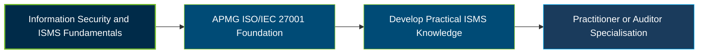

# APMG International ISO/IEC 27001 Foundation Certification Exam Guide

A dedicated study guide and information security reference for candidates preparing for the **APMG International ISO/IEC 27001 Foundation Certification Exam**, covering the requirements, principles, and operation of an Information Security Management System (ISMS).

---

## Exam Overview

The ISO/IEC 27001 Foundation qualification validates foundational knowledge of the ISO/IEC 27001 standard, its role in establishing and maintaining an ISMS, and the information security principles that support continual improvement.

- **Exam Format**: Closed-book, multiple-choice examination.
- **Target Audience**: Information security professionals, IT personnel, internal managers, ISMS implementation and operations teams, consultants, and internal auditors.
- **Prerequisites**: No formal prerequisites are required for the Foundation qualification.

---

## Core Exam Domains & Knowledge Areas

### 1. Overview of ISO/IEC 27001 and Related Best Practices, Standards and Schemes

- Purpose, scope, and key concepts of an Information Security Management System.
- Terms and definitions from ISO/IEC 27000.
- Relationship between ISO/IEC 27001 and related information security standards and schemes.

### 2. Leadership and Support of the ISMS

- Leadership commitment and information security policy.
- Organisational roles, responsibilities, and authorities.
- Resources, competence, awareness, and communication supporting the ISMS.

### 3. Planning and Operation of the ISMS

- Understanding organisational context and interested parties.
- Information security risk assessment and risk treatment principles.
- ISMS objectives, operational planning, and continual improvement.

### 4. Information Security Control Objectives and Controls

- Purpose and selection of information security controls.
- Relationship between risks, control objectives, and the Statement of Applicability.
- Awareness of ISO/IEC 27002 guidance and information security best practices.

### 5. Achieving ISO/IEC 27001 Certification

- Requirements and stages involved in ISMS certification.
- Purpose and operation of internal audits and external certification audits.
- Corrective action, management review, and continual improvement.

---

## Certification Path

---

## Recommended Practice & Study Resources

Use the official ISO/IEC standards and APMG learning materials as the foundation for exam preparation, then reinforce your understanding through practical ISMS concepts.

- **CertsGate**: Explore [APMG ISO/IEC 27001 Foundation preparation resources](https://certsgate.com/exams/apmg-international/iso-iec-27001-foundation) for supplementary study materials and practice.
- **ISO**: Consult the [ISO/IEC 27001 standard](https://www.iso.org/standard/27001) to understand the requirements for establishing, implementing, maintaining, and continually improving an ISMS.
